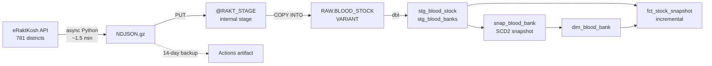

# RaktRadar

Early-warning analytics for blood stock shortages across India, built on live, continuously-updating government data — not a static download.

## The Problem

Blood banks in India run short of specific blood groups in specific regions, and it's usually only visible once it's already urgent. If there's a detectable pattern leading up to a shortage — a region draining faster than it's replenished, a recurring dip tied to certain days or festivals — that's something worth surfacing before it becomes a crisis, not after.

## Architecture



Everything runs daily in **one GitHub Actions workflow** (06:00 UTC): extract → stage → `COPY` → `dbt build` (snapshot, models, 24 tests). No local machine involved.

## Data Source

[eRaktKosh](https://eraktkosh.mohfw.gov.in) — India's national blood stock tracking portal, run by the Ministry of Health and Family Welfare (C-DAC). Public, no authentication required.

The live portal runs two versions in parallel: a legacy jQuery/DataTables site (`.../BLDAHIMS/bloodbank/...`) and a newer React/Ant Design "Beta" rebuild (`.../eraktkoshPortal/...`). This project targets the **Beta API** — cleaner structured JSON, no HTML embedded in response fields, and noticeably fresher `entrydate` timestamps during side-by-side testing.

**Endpoints in use:**
- `POST /eraktkoshPortal/eraktkosh/master/all` — reference data: states, nested districts, blood groups, components. Cached in `master_data.json`, refreshed weekly.
- `GET /eraktkoshPortal/eraktkosh/blood-availability` — live stock. Called **once per district**; the response carries every component × blood group per blood bank.

## Data Model

| Object | Type | Grain |
|---|---|---|
| `RAW.BLOOD_STOCK` | table (`VARIANT`) | blood bank × run, raw API entry + `_run_id`, `_source_file`, `_loaded_at` |
| `stg_blood_stock` | view | run × blood bank × component × blood group (~405k rows/run) |
| `stg_blood_banks` | view | blood bank, latest run |
| `snap_blood_bank` | dbt snapshot | blood bank version (check strategy on name, address, contact, category, type, location) |
| `dim_blood_bank` | table | blood bank version (SCD2) |
| `fct_stock_snapshot` | incremental | run × blood bank × component × blood group, keyed to the dim version valid for that run |
| `alert_critical_shortages` | view | district × blood group that just ran out of red cells (all reporting banks at 0, had stock last run) |
| `agg_district_stock` | incremental | run × district × component × blood group rollup for the dashboard |
| `ref_districts` | seed | state and district names for the portal's codes |

**Snowflake layout:** `RAKTRADAR` database with `RAW` and `ANALYTICS` schemas, an X-Small warehouse with 60s auto-suspend, and three roles — `RAKT_LOADER` (writes `RAW`), `RAKT_TRANSFORMER` (reads `RAW`, builds `ANALYTICS`), `RAKT_REPORTER` (reads `ANALYTICS`). CI authenticates as key-pair service users.

## Status

- [x] Reverse-engineer and verify the reference-data and stock endpoints
- [x] Async extractor (`aiohttp`, `tenacity` retries, second pass for failed districts) writing gzipped NDJSON
- [x] Daily GitHub Actions schedule, independent of any local machine
- [x] Snowflake RBAC, internal stage, file format and raw table; SQL deployed from this repo via Snowflake's Git integration
- [x] Load step: `PUT` + `COPY INTO`, with the raw file kept as a 14-day artifact
- [x] dbt staging, SCD2 blood bank dimension, incremental stock fact, 24 data tests
- [x] CI on every PR: `ruff`, `sqlfluff`, `dbt parse`
- [x] Streamlit in Snowflake dashboard: current stock by state/district, daily trend, new shortages, stale reporting
- [ ] District-level map (needs eRaktKosh → LGD/GeoJSON district mapping)
- [x] Daily email for new red-cell shortages (Snowflake alert + email notification integration), with a "no data today" warning
- [ ] Descriptive and diagnostic analysis — chronic shortages, weekday and festival effects

## Notable Technical Decisions

**Extraction**
- **One call per district, not per blood group × component.** Omitting `componentId`/`bloodGroupId` returns everything for each blood bank. Verified against all 140 filtered calls for 20 random districts (identical hospitals, cells and values) before switching: **109,340 calls → 781, 40–80 min → ~1.5 min**, and far less load on a government server.
- **Dropped the census-2011 reference dataset.** It undercounted Delhi (9 districts vs. the current 11) and used a different code scheme than eRaktKosh's internal IDs. Reference data now comes from the portal's own `master/all` endpoint, cross-validated against the site's DOM.
- **Zero-padding mismatch.** The old reference source stored district codes as `"098"`; the API expects `"98"`. Fixed at the point of use, not as a blanket rule, since state codes needed the opposite treatment.
- **`master/all` requires a JSON body.** A form-encoded POST returns `415 Unsupported Media Type`.

**Loading**
- **Git is not the data store.** Raw files go to a Snowflake internal stage; the repo only holds code. (An earlier version committed data and silently lost ~11 days when the output filename changed — the artifact backup exists because of that.)
- **`COPY` names the exact file it loads** (`FILES = (...)`). `TRUNCATE` clears Snowflake's load history, so a folder-wide `COPY` would reload old files.

**Modelling**
- **ELT, not ETL.** The raw API entry lands untouched in a `VARIANT`; all parsing lives in dbt, so parsing rules can change and be re-applied to history.
- **The portal's stock strings need cleaning.** Stock arrives as `"A-Ve : 5, AB+Ve : 20"` with label variants (`A -ve`, `Oh+VE`), normalised to `A-`, `OH+`, etc. Some cells are listed twice with *different* counts (separate stock entries), so they're summed rather than de-duplicated.
- **Stale timestamps are a signal, not noise.** Some banks carry `entrydate` values months old; `is_stale` flags anything older than 7 days, because "not available" there likely means "unreported", not "empty".
- **SCD2 versions are bounded by `run_id`, not snapshot timestamps.** The snapshot runs after the load, so `dbt_valid_from` is always later than the fetch it describes; joining on it would attach each run to the previous version.
- **`hospitalCode` is the join key**, not the blood bank name — names vary in capitalisation and spacing across records.

## Tech Stack

| Layer | Tools |
|---|---|
| Extraction | Python 3.11, `aiohttp`, `tenacity`, `orjson` |
| Orchestration | GitHub Actions (cron + `workflow_dispatch`) |
| Warehouse | Snowflake (internal stage, `VARIANT`, RBAC, Git integration) |
| Transformation | dbt Core + dbt-snowflake (snapshots, incremental models, tests) |
| CI | `ruff`, `sqlfluff`, `dbt parse` |
| Alerting | Snowflake alerts, `SYSTEM$SEND_SNOWFLAKE_NOTIFICATION` |
| Dashboard | Streamlit in Snowflake, deployed from this repo |

## Repository Layout

```
python/data_extraction.py      # async extractor -> blood_data_<run>.ndjson.gz
python/load_to_snowflake.py    # PUT + COPY INTO RAW.BLOOD_STOCK
dbt/                           # staging, snapshot, marts, tests
snowflake_setup.sql            # warehouse, schemas, roles, stage, raw table
snowflake_service_user.sql     # key-pair service users for CI
snowflake_git_integration.sql  # lets Snowflake run SQL straight from this repo
snowflake_alerts.sql           # daily shortage email (procedure + alert)
snowflake_streamlit.sql        # deploys the dashboard from streamlit/
streamlit/streamlit_app.py     # dashboard
.github/workflows/             # daily pipeline + PR CI
```

## Author

Naga Mohan Madicharla
[github.com/unknownsteve7](https://github.com/unknownsteve7) · [nagamohan.me](https://nagamohan.me)
