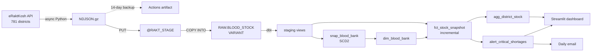

# RaktRadar

[](https://github.com/unknownsteve7/RaktRadar/actions/workflows/collect_blood_data.yml)
[](https://github.com/unknownsteve7/RaktRadar/actions/workflows/ci.yml)

Early-warning analytics for blood stock shortages across India, built on live, continuously-updating government data — not a static download.

A daily pipeline pulls stock for every blood bank in the country from the national eRaktKosh portal, lands it in Snowflake, models its history with dbt, and serves it through a Streamlit dashboard and a shortage email.

| | |
|---|---|
| **Coverage** | ~4,700 blood banks · 781 districts · 36 states and UTs |
| **Volume** | ~405k stock cells per run (blood bank × component × blood group) |
| **Daily run** | ~2 min end to end: 781 API calls, load, `dbt build` with 32 tests |
| **Outputs** | Streamlit dashboard · daily shortage email · SCD2 + incremental history in Snowflake |

## Contents

- [The Problem](#the-problem)
- [How It Works](#how-it-works)
- [Data Source](#data-source)
- [Data Model](#data-model)
- [Dashboard and Alerts](#dashboard-and-alerts)
- [Data Quality and CI](#data-quality-and-ci)
- [Setup](#setup)
- [Repository Layout](#repository-layout)
- [Tech Stack](#tech-stack)
- [Design Decisions](#design-decisions)
- [Roadmap](#roadmap)

## The Problem

Blood banks in India run short of specific blood groups in specific regions, and it's usually only visible once it's already urgent. If there's a detectable pattern leading up to a shortage — a region draining faster than it's replenished, a recurring dip tied to certain days or festivals — that's something worth surfacing before it becomes a crisis, not after.

## How It Works



**Every day, with no local machine involved:**

| Time (UTC) | Step | Where |
|---|---|---|
| 06:00 | Extract stock for all 781 districts (~1.5 min) | GitHub Actions |
| | Keep the raw file as a 14-day artifact | GitHub Actions |
| | `PUT` to the internal stage, `COPY INTO RAW.BLOOD_STOCK` | GitHub Actions → Snowflake |
| | `dbt build`: seed, snapshot, models, 32 tests | GitHub Actions → Snowflake |
| 08:00 | Email new shortages, or a "no data today" warning | Snowflake alert |
| any time | Dashboard reads the latest models | Streamlit in Snowflake |

## Data Source

[eRaktKosh](https://eraktkosh.mohfw.gov.in) — India's national blood stock tracking portal, run by the Ministry of Health and Family Welfare (C-DAC). Public, no authentication required.

The live portal runs two versions in parallel: a legacy jQuery/DataTables site (`.../BLDAHIMS/bloodbank/...`) and a newer React/Ant Design "Beta" rebuild (`.../eraktkoshPortal/...`). This project targets the **Beta API** — cleaner structured JSON, no HTML embedded in response fields, and noticeably fresher `entrydate` timestamps during side-by-side testing.

| Endpoint | Purpose |
|---|---|
| `POST /eraktkoshPortal/eraktkosh/master/all` | Reference data: states, nested districts, blood groups, components. Cached in `master_data.json`, refreshed weekly. |
| `GET /eraktkoshPortal/eraktkosh/blood-availability` | Live stock. Called **once per district**; the response carries every component × blood group for each blood bank. |

## Data Model

| Layer | Object | Type | Grain |
|---|---|---|---|
| Raw | `RAW.BLOOD_STOCK` | table (`VARIANT`) | blood bank × run: raw API entry + `_run_id`, `_source_file`, `_loaded_at` |
| Staging | `stg_blood_stock` | view | run × blood bank × component × blood group |
| | `stg_blood_banks` | view | blood bank, latest run |
| | `ref_districts` | seed | state and district names for the portal's codes |
| Snapshot | `snap_blood_bank` | dbt snapshot | blood bank version (name, address, contact, category, type, location) |
| Marts | `dim_blood_bank` | table | blood bank version (SCD2) |
| | `fct_stock_snapshot` | incremental | run × blood bank × component × blood group, keyed to the dim version valid for that run |
| | `agg_district_stock` | incremental | run × district × component × blood group, for the dashboard |
| | `alert_critical_shortages` | view | district × blood group that just ran out of red cells |

**Snowflake layout:** one `RAKTRADAR` database with `RAW` and `ANALYTICS` schemas, and an X-Small warehouse with 60s auto-suspend. Access is split across three roles:

| Role | Can | Used by |
|---|---|---|
| `RAKT_LOADER` | write `RAW` | `RAKT_LOADER_SVC` (load step) |
| `RAKT_TRANSFORMER` | read `RAW`, build `ANALYTICS` | `RAKT_TRANSFORMER_SVC` (dbt), shortage alert |
| `RAKT_REPORTER` | read `ANALYTICS` | Streamlit dashboard |

Service users are `TYPE = SERVICE` with key-pair authentication.

## Dashboard and Alerts

**Streamlit dashboard** (Snowsight → Projects → Streamlit → RaktRadar)
- Headline numbers: units on hand, blood banks reporting, district × group cells at zero
- Current stock by state, or by district within a state, and a district × blood group grid sorted lowest first
- Daily trend by blood group
- New shortages (the same list as the email)
- Stale-reporting share by state
- Filters for component, blood groups and state

**Daily shortage email** (08:00 UTC / 13:30 IST)

A district × blood group is flagged when **every reporting blood bank now has 0 units of Packed Red Blood Cells and Whole Blood**, and **those same banks had stock in the previous run**. Only new shortages are sent, so chronic gaps don't repeat daily, and banks that have gone silent are excluded so they can't look like shortages. If no data loaded that day, the email says so instead. Nothing is sent on a quiet day.

## Data Quality and CI

- **32 dbt tests run every day:** not-null and accepted values on key columns, unique grain on every model, fact → dimension relationships, one current version per blood bank, and source freshness on the raw table (warn after 26h, error after 50h).
- **Every pull request** runs `ruff` on the Python, plus `dbt parse` and `sqlfluff` (Snowflake dialect) on the dbt project. Neither needs warehouse credentials.
- **`dbt build` runs after the daily commit step**, so a failing model or test never blocks the data from being saved.

## Setup

SQL lives in this repo and Snowflake runs it straight from GitHub through a Git repository object. Deploying a change is always the same two lines:

```sql
alter git repository RAKTRADAR.PUBLIC.RAKTRADAR_REPO fetch;
execute immediate from @RAKTRADAR.PUBLIC.RAKTRADAR_REPO/branches/main/<file>.sql;
```

**First-time setup, in order (as `ACCOUNTADMIN`):**

1. **Warehouse, schemas, roles, stage, raw table:** run [`snowflake_setup.sql`](snowflake_setup.sql) in a worksheet.
2. **Git integration:** run [`snowflake_git_integration.sql`](snowflake_git_integration.sql) in a worksheet. Every later script can be run from the repo.
3. **Service users:**
   - Generate a key pair:
     ```bash
     openssl genrsa 2048 | openssl pkcs8 -topk8 -inform PEM -out rsa_key.p8 -nocrypt
     openssl rsa -in rsa_key.p8 -pubout -out rsa_key.pub
     ```
   - Run [`snowflake_service_user.sql`](snowflake_service_user.sql).
   - Set the public key on `RAKT_LOADER_SVC` and `RAKT_TRANSFORMER_SVC`.
4. **GitHub secrets:** `SNOWFLAKE_ACCOUNT` (`<org>-<account>`), `SNOWFLAKE_USER` (`RAKT_LOADER_SVC`), and `SNOWFLAKE_PRIVATE_KEY` (the contents of `rsa_key.p8`).
5. **First run:** Actions → *Collect Blood Data* → *Run workflow*. This loads `RAW` and builds `ANALYTICS`.
6. **Email:**
   - Verify your email on your Snowflake user.
   - Create the `RAKT_EMAIL` notification integration. See the commented block in [`snowflake_alerts.sql`](snowflake_alerts.sql); it's kept out of the repo so no address is committed.
   - Deploy `snowflake_alerts.sql`.
7. **Dashboard:** deploy [`snowflake_streamlit.sql`](snowflake_streamlit.sql). Re-run it after app changes, because Snowflake copies the app files only when the app is created.

**Local development:**

```bash
pip install -r requirements.txt
python python/data_extraction.py          # writes blood_data_<run>.ndjson.gz (~30 s)
ruff check python/ streamlit/
cd dbt && dbt parse --profiles-dir . && sqlfluff lint models tests
```

`dbt parse` and `sqlfluff` work offline. Set `SNOWFLAKE_ACCOUNT` and `SNOWFLAKE_PRIVATE_KEY` to any value for `dbt parse`.

## Repository Layout

```
python/
  data_extraction.py           # async extractor -> blood_data_<run>.ndjson.gz
  load_to_snowflake.py         # PUT + COPY INTO RAW.BLOOD_STOCK
dbt/
  models/staging/              # stg_blood_stock, stg_blood_banks, sources
  models/marts/                # dim, fact, dashboard rollup, shortage view
  snapshots/                   # snap_blood_bank (SCD2)
  seeds/                       # ref_districts
  tests/                       # grain and SCD2 integrity tests
streamlit/streamlit_app.py     # dashboard
snowflake_setup.sql            # warehouse, schemas, roles, stage, raw table
snowflake_git_integration.sql  # lets Snowflake run SQL from this repo
snowflake_service_user.sql     # key-pair service users for CI
snowflake_alerts.sql           # shortage email procedure + alert
snowflake_streamlit.sql        # dashboard deployment
.github/workflows/
  collect_blood_data.yml       # daily pipeline
  ci.yml                       # PR checks
```

## Tech Stack

| Layer | Tools |
|---|---|
| Extraction | Python 3.11, `aiohttp`, `tenacity`, `orjson` |
| Orchestration | GitHub Actions (cron + `workflow_dispatch`) |
| Warehouse | Snowflake: internal stage, `VARIANT`, RBAC, Git integration |
| Transformation | dbt Core + dbt-snowflake: seeds, snapshots, incremental models, tests |
| Serving | Streamlit in Snowflake |
| Alerting | Snowflake alerts, `SYSTEM$SEND_SNOWFLAKE_NOTIFICATION` |
| CI | `ruff`, `sqlfluff`, `dbt parse` |

## Design Decisions

### Extraction
- **One call per district, not per blood group × component.** Omitting `componentId` and `bloodGroupId` returns everything for each blood bank. Before switching, it was verified against all 140 filtered calls for 20 random districts: identical hospitals, cells and values. The change took a run from **109,340 calls to 781, and from 40–80 min to ~1.5 min**, with far less load on a government server.
- **Dropped the census-2011 reference dataset.** It undercounted Delhi (9 districts vs. the current 11) and used a different code scheme than eRaktKosh's internal IDs. Reference data now comes from the portal's own `master/all` endpoint, cross-validated against the site's DOM.
- **Zero-padding mismatch.** The old reference source stored district codes as `"098"`, but the API expects `"98"`. Fixed at the point of use, not as a blanket rule, since state codes needed the opposite treatment.
- **`master/all` requires a JSON body.** A form-encoded POST returns `415 Unsupported Media Type`.

### Loading
- **Git is not the data store.** Raw files go to a Snowflake internal stage, and the repo holds only code. An earlier version committed data and silently lost ~11 days when the output filename changed; the artifact backup exists because of that.
- **`COPY` names the exact file it loads** (`FILES = (...)`). `TRUNCATE` clears Snowflake's load history, so a folder-wide `COPY` would reload old files.

### Modelling
- **ELT, not ETL.** The raw API entry lands untouched in a `VARIANT`, and all parsing lives in dbt, so parsing rules can change and be re-applied to history.
- **The portal's stock strings need cleaning.** Stock arrives as `"A-Ve : 5, AB+Ve : 20"`, with label variants such as `A -ve` and `Oh+VE`. These are normalised to `A-`, `OH+` and so on. Some cells are listed twice with *different* counts (separate stock entries), so they're summed rather than de-duplicated.
- **Stale timestamps are a signal, not noise.** Some banks carry `entrydate` values months old. `is_stale` flags anything older than 7 days, because "not available" there likely means "unreported", not "empty".
- **SCD2 versions are bounded by `run_id`, not snapshot timestamps.** The snapshot runs after the load, so `dbt_valid_from` is always later than the fetch it describes, and joining on it would attach each run to the previous version.
- **`hospitalCode` is the join key**, not the blood bank name, since names vary in capitalisation and spacing across records.

### Serving
- **Alerts and the dashboard live inside Snowflake.** No email credentials or app hosting are needed, and the recipient is set only in the notification integration, never in the repo.
- **The dashboard runs on the warehouse runtime.** The container runtime needs a compute pool, and the warehouse runtime's older Streamlit (< 1.23) shapes which APIs the app can use.

## Roadmap

- [x] Reverse-engineer and verify the reference-data and stock endpoints
- [x] Async extractor with retries and a second pass for failed districts
- [x] Daily GitHub Actions schedule, independent of any local machine
- [x] Snowflake RBAC, stage, raw table, and SQL deployed from this repo
- [x] Load step with artifact backup
- [x] dbt staging, SCD2 dimension, incremental fact, 32 tests
- [x] CI on every pull request
- [x] Streamlit dashboard
- [x] Daily shortage email
- [ ] District-level map (needs eRaktKosh → LGD/GeoJSON district mapping)
- [ ] Descriptive analysis: which regions and blood groups run chronically short vs. surplus
- [ ] Diagnostic analysis: weekday effects, festival correlation
- [ ] Early-warning trend flag, if the data supports it

## Author

Naga Mohan Madicharla
[github.com/unknownsteve7](https://github.com/unknownsteve7) · [nagamohan.me](https://nagamohan.me)
